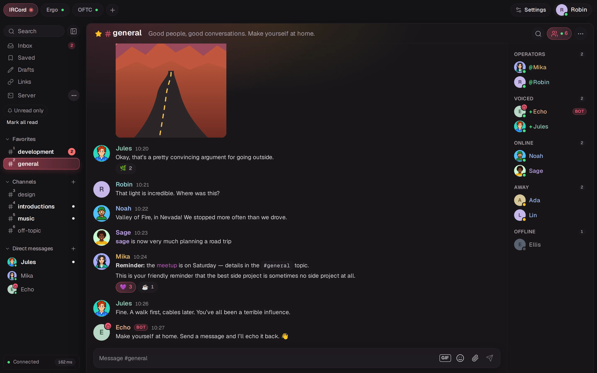

# IRCord Desktop

IRCord Desktop puts your IRC networks in one native app. Connect to the public IRCord server or a self-hosted instance and receive desktop notifications while IRCord is open.



## Download

| Platform | Installer |
| --- | --- |
| macOS, Apple Silicon | [Disk image](https://github.com/ircord/desktop/releases/latest/download/IRCord-macOS-Apple-Silicon.dmg) |
| Windows, x64 | [Setup program](https://github.com/ircord/desktop/releases/latest/download/IRCord-Windows-x64-setup.exe) |
| Linux, x64 | [Debian package](https://github.com/ircord/desktop/releases/latest/download/IRCord-Linux-x64.deb) |

The macOS app uses ad hoc signing and has no notarization. The Windows installer has no publisher signature.
See [releases](https://github.com/ircord/desktop/releases) for release notes and checksums.

## Desktop controls

Use **Open IRCord** or **Quit IRCord** in the macOS menu bar, Windows notification area, or Linux system tray.
The Linux tray requires a desktop environment that supports status indicators.

On macOS and Windows, IRCord checks for updates at startup and asks before it installs one.
To check manually, select **Check for updates** from Settings → About or the tray menu.
On Linux, install the latest Debian package when a new version is available.

## Connect to IRCord

Open the app and choose an IRCord server. The suggested address is `https://chat.ircord.com`.
Select **Check server** to verify the address and see the server’s registration policy. Select **Continue** to sign in.
IRCord remembers your server and sign-in between launches. Select **Change IRCord server** from the sign-in screen or your profile menu to switch servers.

## Build from source

The Tauri app embeds a static build from the sibling `frontend/` checkout.

## Prerequisites

- A recursive checkout of the [IRCord development workspace](https://github.com/ircord/dev-environment).
- Bun 1.4.4, Rust, and the [Tauri prerequisites](https://v2.tauri.app/start/prerequisites/) for your platform.

## Procedure

1. Run `bun install --frozen-lockfile` in `frontend/`.
2. Run `bun install --frozen-lockfile` in `desktop/`.
3. Run `bun run build` in `desktop/`.
4. Open the bundle from `desktop/src-tauri/target/release/bundle/`.

Build on the platform and architecture that will run the bundle.
The build generates the Mac icon from `assets/macos-icon.svg` and the Windows and Linux icons from the frontend artwork.
On macOS, use `bun run build --bundles app` to build the application without a disk image.

To build test installers in GitHub Actions, run [Build desktop installers](https://github.com/ircord/desktop/actions/workflows/build-installers.yaml) with the full frontend commit SHA.
Each artifact includes the desktop and frontend source revisions in `build-info.txt`.

## Verification

Set `IRCORD_DESKTOP_BACKEND_URL` before launching the executable to supply the address ahead of time.
The app accepts HTTPS server addresses and local HTTP addresses on `localhost` or `127.0.0.1`.
Each server has its own browser data. On macOS versions before 14, the app uses temporary browser data.

Run `bun tauri dev` in `desktop/` for frontend hot reload on port 4789.
It connects directly to the local Go backend on port 8080. Start Go with `make backend` in the workspace root.
Use **Change IRCord server** to save a different address for hot reload, or set `IRCORD_DESKTOP_BACKEND_URL` for a single launch.
Run `bun run dev:bundle` to test the static frontend in Tauri.

To check a macOS bundle in WebKit, start a disposable Go backend on `127.0.0.1:41987` with registration enabled.
From `desktop/`, run the following command after installing the frontend's Playwright WebKit browser.

```sh
bun scripts/verify-frontend.mjs http://127.0.0.1:41987
```

## Publish a release

For native changes, move the desktop changelog entries into a dated version section.
Run [Publish desktop release](https://github.com/ircord/desktop/actions/workflows/publish.yaml) with that desktop version and a published frontend tag.
Select **Build and verify the release assets without publishing them** to test the release workflow.

The frontend workflow dispatches desktop builds after stable frontend releases.
These builds increment the desktop patch version, keep the last released native code, and embed the new frontend.

For releases with in-app updates, set the repository Actions secret `TAURI_SIGNING_PRIVATE_KEY` to the key that matches the public key in `src-tauri/tauri.conf.json`.
If the key has a password, set `TAURI_SIGNING_PRIVATE_KEY_PASSWORD` as well.
Keep a secure backup so future releases can update existing installs.
The release verifies both update packages before publishing `latest.json`.

## Recovery

If the app cannot reach the server, open **Change IRCord server** and check the address.
To clear a saved address while the app is closed, remove the `server` file from the app's configuration directory.
On macOS, the directory is `~/Library/Application Support/com.ircord.desktop/`.
